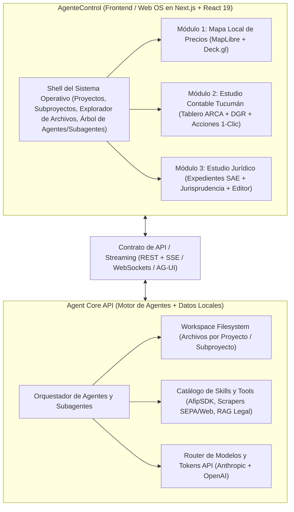

# Blueprint de Arquitectura y Mercado — `AgenteControl`

Este documento consolida la investigación técnica, las librerías open-source existentes para no empezar desde cero, la estrategia de uso eficiente de tokens y el diseño modular de `AgenteControl` junto a sus tres aplicaciones verticales iniciales.

---

## 1. Paradigma General: "Sistema Operativo Visual sobre un Core de Agentes"

La arquitectura desacopla el motor agéntico de la experiencia visual del usuario final (100% Web Apps dedicadas, sin depender de WhatsApp):

* **Capa Inferior — Agent Core (Motor Backend):**
  * Ejecuta el runtime de agentes y subagentes con **tools**, **skills específicos**, **acceso al sistema de archivos (filesystem)** y memoria de trabajo.
  * Resuelve las integraciones pesadas: Web Services de ARCA (ex AFIP), lectura de PDFs impositivos o judiciales, scrapers de precios locales e indexación de bases de datos locales.
* **Capa Superior — `AgenteControl` (Web OS + Apps Verticales):**
  * Es la ventana web que se conecta a la API del Core.
  * Gestiona la jerarquía **Usuario → Proyectos → Subproyectos → Archivos + Agentes/Subagentes + Skills**.
  * Presenta interfaces gráficas específicas de dominio (*Domain Views* y *Generative UI*): mapas interactivos por barrios, tableros fiscales con botones de acción directa ("Consultar estado en ARCA", "Conciliar mes") y estaciones de trabajo jurídicas de pantalla dividida.



---

## 2. Ecosistema Open Source Reutilizable (Para No Empezar en Cero)

### 2.1. Capa de Interfaz Agéntica y Control Plane (`AgenteControl`)
* **AG-UI Protocol (`ag-ui-protocol/ag-ui`):** Protocolo abierto basado en eventos (SSE/WebSockets) diseñado para conectar cualquier backend propio de agentes con un frontend React/Next.js. Estandariza mensajes en streaming, ejecución de *tool calls*, progreso de subagentes, deltas de estado/archivos y confirmaciones humanas (*Human-in-the-loop*).
* **`assistant-ui` (`assistant-ui/assistant-ui` + `@assistant-ui/react-ag-ui`):** Primitivas React estilo `shadcn/ui` para renderizar hilos de agentes, **árboles anidados de subagentes** y **Tool UIs** (componentes visuales React que reemplazan el JSON crudo cuando un agente ejecuta una herramienta).
* **CopilotKit (`CopilotKit/CopilotKit`):** Sincronización bidireccional de estado entre la pantalla activa de la Web App (filtros, tablas, documentos abiertos) y el agente.
* **Referencias Open Source de "Agent OS / Workspaces":**
  * **Paperclip (`paperclipai/paperclip`):** Dashboard en React para orquestar jerarquías de agentes/subagentes, asignar skills y auditar costos de tokens por tarea/proyecto.
  * **OpenAgents Workspace (`openagents-org`) & Neutree (`neutree-ai/agent-platform`):** Arquitecturas multi-agente con contexto compartido de archivos en React + Tailwind + `shadcn/ui`.
  * **Layout tipo IDE en navegador:** `react-resizable-panels` + `@monaco-editor/react` / `CodeMirror` + `PDF.js` + `TanStack Table`.

### 2.2. Módulo 1: Inteligencia de Precios Local + Mapa Visual (`market-radar`)
* **Fuentes Abiertas en Argentina:**
  * **Base Oficial SEPA / Precios Claros (`datos.produccion.gob.ar` / `datos.gob.ar`):** Millones de registros diarios de precios minoristas y mayoristas con **código EAN (código de barras)** y **coordenadas GPS de cada sucursal**.
  * **`OpenDataCordoba/precios_claros`:** Scrapers y pipelines open-source en Python para ingesta y normalización histórica de Precios Claros/SEPA.
* **Scrapers y Monitoreo Competitivo:**
  * **StrawBoi Pricing Intelligence (`StrawBoi/strawbooi-pricing-intelligence`)** y **PriceGhost (`clucraft/PriceGhost`):** Bases open-source en TypeScript/Python para historial de variaciones, detección de anomalías y alertas.
  * **Crawl4AI / Crawlee + Playwright:** Extracción sobre cadenas regionales de Tucumán (**Gómez Pardo**, **Comodín**, **Atlas Hipermayorista**), tiendas VTEX/Tiendanube/WooCommerce, **MercadoLibre** (filtrado por CP `4000`/`4107`) y apps de delivery geolocalizadas por barrio.
* **Mapa Geoespacial:**
  * **PostgreSQL + PostGIS + Índice hexagonal H3 + MapLibre GL JS / Deck.gl:** Visualización de mapas de calor por barrios (Centro, Barrio Norte, Barrio Sur, Yerba Buena, Tafí Viejo, Banda del Río Salí), dispersión de precios, quiebres de stock y margen sugerido.
* **Rol de la IA:** *Entity Resolution* (unificar productos equivalentes sin código de barras entre distintos comercios usando embeddings + modelos livianos en lote).

### 2.3. Módulo 2: Suite Web para Estudios Contables en Tucumán (`contadores-ar`)
* **Contexto de Mercado:** Herramientas nacionales como *Aconpy*, *Cuonti*, *Kontari* o *SOS Contador* cubren Nación (**ARCA**, ex AFIP), pero dejan fricción operativa en normativas provinciales y municipales de Tucumán (**DGR Tucumán — Ingresos Brutos / aplicativo `SiAPre` / Salud Pública / padrones de retenciones y percepciones** y **DIM San Miguel de Tucumán — `TEM`**).
* **SDKs y Herramientas Base:**
  * **`AfipSDK` (`AfipSDK/afip.js` / `AfipSDK/afip.py`):** Integración directa con Web Services de ARCA (`wsfev1` facturación electrónica, `ws_sr_constancia_inscripcion` padrón/estado de CUIT, automatizaciones de *Mis Comprobantes* y VEPs).
  * **`genuinefafa/simple-procesador-facturas` + Visión con *Structured Outputs* (`Zod` / `Pydantic`):** Extracción precisa de CAE, CUIT, alícuotas de IVA (21%, 10.5%, 27%), percepciones IIBB Tucumán y retenciones bancarias desde PDFs o imágenes subidas a la carpeta del subproyecto.
* **Flujo en la Web App:**
  * Cada cliente del estudio es un **Subproyecto** aislado con sus archivos, credenciales/certificados y estado al día.
  * Tablero general de cartera con semáforo de vencimientos/deudas/recategorizaciones y botones de 1 clic (*"Consultar estado en ARCA"*, *"Conciliar comprobantes del mes"*, *"Generar papel de trabajo SiAPre / Libro IVA"*).
  * Ventana web opcional de autogestión cliente-contador (donde el comercio sube sus facturas y descarga sus comprobantes/VEPs sin usar WhatsApp).

### 2.4. Módulo 3: Workstation Jurídica y Jurisprudencia Verificada (`legal-tuc`)
* **Contexto en Tucumán:** El litigio provincial tramita en el **Portal del SAE (`portaldelsae.justucuman.gov.ar`)** y la **Corte Suprema de Justicia de Tucumán (CSJT)** regula estrictamente el uso de IA (*Acordada 729/25*), sancionando citas inexistentes inventadas por chatbots genéricos. El diferencial central del producto es **Cero Alucinaciones: toda cita enlaza al documento oficial real**.
* **Bases Abiertas y Conectores Existentes:**
  * **`legalize-dev/legalize-ar`:** Legislación nacional argentina (**InfoLeg**) limpia y versionada en archivos Markdown por artículo, lista para indexar.
  * **`mcp-legal-ar` / `claude-for-legal-argentina`:** Conectores open-source (MCP) hacia **SAIJ, InfoLeg y CSJN**.
  * **`datos-justicia-argentina/Tesauro-Saij-de-Derecho-Argentino` + `datos.jus.gob.ar`:** Vocabulario jurídico controlado oficial para mejorar precisión de búsqueda.
  * **Base Local de Jurisprudencia de Tucumán (`justucuman.gov.ar`):** Indexación local de fallos de la CSJT y Cámaras provinciales combinando **Búsqueda Híbrida (`pgvector` semántico + `BM25` léxico exacto por número de ley/artículo/expediente)** y un subagente verificador de citas antes de redactar.
* **Flujo en la Web App:**
  * Cada expediente es un **Subproyecto** con sus PDFs, línea de tiempo procesal, buscador de precedentes por Sala/Juzgado y editor de escritos con inserción verificada de fallos.

---

## 3. Estrategia de Consumo y Ruteo de Tokens API (\$200 OpenAI + \$200 Anthropic)

Ambos planes superiores otorgan **\$200 USD/mes cada uno (\$400 USD/mes combinados)** en créditos de API al vincular las organizaciones en *OpenAI Platform* y *Claude Console* (sin acumulación mes a mes). Para maximizar su rendimiento tanto en desarrollo local como en ejecución del Core:

1. **Principio "Código Determinista Primero (85% / 15%)":** Todo lo que sea scraping estructurado, consultas SOAP/REST a ARCA, cruces por código EAN o búsqueda SQL/BM25 corre en código tradicional (costo de tokens \$0). Los LLMs intervienen únicamente donde agregan inteligencia real (OCR complejo, *Entity Resolution*, análisis documental y redacción).
2. **Enrutamiento por Complejidad + Prompt Caching + Batch API:**
   * **Tareas frecuentes / masivas:** Modelos rápidos y económicos (`Haiku` / `Mini`) con *Batch API* (50% off en indexación asíncrona) y *Prompt Caching* (hasta 90% off en instrucciones de skills y leyes/contextos repetidos).
   * **Razonamiento profundo:** Modelos *Frontier* (`Sonnet` / `Opus` / `Pro`) reservados para redacción jurídica final, análisis fiscal complejo o agentes coordinadores.
3. **Balanceo Automático Mensual:** Un router en el Core alterna entre Anthropic y OpenAI según el tipo de tarea y el saldo remanente del ciclo de facturación para aprovechar el 100% de ambos cupos antes de su fecha de expiración mensual.

---

## 4. Estructura Objetivo del Monorepo (`pnpm`)

```text
AgenteControl/
├── apps/
│   └── web-os/                  # Aplicación principal Next.js (App Router, React 19, Tailwind):
│                                # Shell del Sistema Operativo + Vistas dinámicas según el módulo activo
├── packages/
│   ├── core-sdk/                # Cliente TypeScript desacoplado hacia la API del Agent Core
│   │                            # (Proyectos, Subproyectos, Filesystem API, Agentes/Subagentes, Stream SSE/WS)
│   ├── ui-kit/                  # Sistema de diseño compartido: Explorador de archivos, Visores PDF/CSV,
│   │                            # Árbol de ejecución de Subagentes, Tool-UIs y modales de confirmación
│   └── modules/                 # Aplicaciones verticales enchufables sobre el OS:
│       ├── market-radar/        # Mapa geoespacial de precios locales y comparador competitivo
│       ├── contadores-ar/       # Tablero fiscal ARCA + DGR Tucumán + gestión de cartera por CUIT
│       └── legal-tuc/           # Workstation de expedientes SAE + buscador de jurisprudencia verificada
├── docs/
│   ├── ARQUITECTURA_Y_PLAN.md   # Este documento
│   └── core-api/                # Especificación técnica del Agent Core (a completar con el equipo de Core)
├── pnpm-workspace.yaml
└── package.json
```

---

## 5. Hoja de Ruta de Construcción

* **Fase 0 — Contrato UI ↔ Core:** Revisar la documentación del Core en [`docs/core-api/`](./core-api/README.md) y cerrar el esquema exacto de endpoints y eventos en tiempo real.
* **Fase 1 — `AgenteControl` Shell (El Sistema Operativo Base):** Construir `apps/web-os`, `packages/core-sdk` y `packages/ui-kit` para poder crear usuarios, proyectos y subproyectos, navegar/visualizar archivos en vivo y ejecutar/monitorear agentes y subagentes con sus skills.
* **Fase 2 — Primer Módulo Vertical MVP:** Montar la primera aplicación de nicho completa sobre el Shell y validar con primeros usuarios reales en San Miguel de Tucumán.
* **Fase 3 — Expansión a los Módulos 2 y 3:** Reutilizar el 100% del Shell, permisos, visor de archivos y conexión al Core agregando únicamente las vistas específicas y los paquetes de *skills* de cada nuevo rubro.
